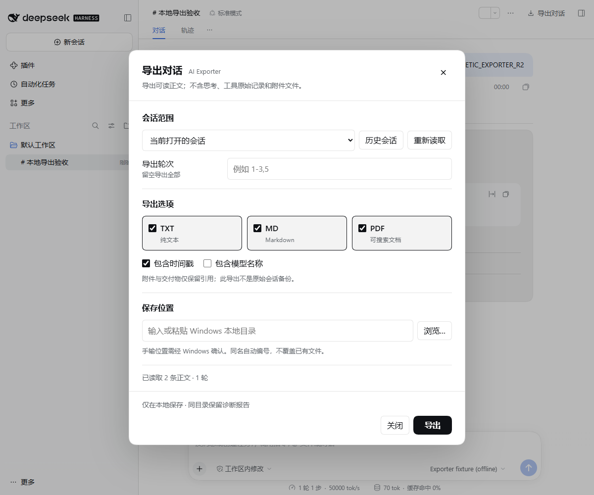

# DSH AI Exporter

[简体中文](README.md) · [Download v0.1.5](https://github.com/379385796-sys/dsh-ai-exporter/releases/tag/v0.1.5) · [Compatibility](docs/COMPATIBILITY.md)

Export current or historical DSH conversations as **TXT, Markdown, and searchable PDF** for local reading and reference. Conversion runs locally without uploading conversation text.

## Features

- Export the current conversation or select a historical session in the panel.
- Keep all rounds or select ranges such as `1-3,5`.
- Select one or more formats and choose whether to show timestamps and model information.
- Type, paste, or browse a local folder and confirm through a native Windows dialog. Retain the recent directory and use Save As for a single format. Existing files are never overwritten.
- Filter internal content and recognized rewind events. Unknown events and unfinished replies produce diagnostics and block incomplete export by default.

Exports contain **readable message bodies**, without reasoning, raw tool records or internal context. Attachments and deliverables remain references; their files are never read or embedded. Math and Mermaid remain source text. This is not a full raw-session backup and cannot restore a DSH environment.

**New in 0.1.5:** stale previews are discarded on switching, reloading and closing. Partial-export consent applies only to the reviewed snapshot; changed data requires another review. The dialog follows native theme controls, supports Chinese and English, and respects reduced motion. [Changelog](CHANGELOG.md)

## Installation

Current version: **0.1.5**, targeting Windows DSH Desktop. The package declares `0.2.1-rc.2 || 0.2.1-rc.3 || 0.2.1-rc.5 || 0.2.2-rc.1` and Node **22+**. See [compatibility](docs/COMPATIBILITY.md) for current 0.2.2-rc.1 and historical RC5/RC2/RC3 evidence. Other platforms are untested.

**PDF requires an existing Edge or Chrome installation.** No browser is bundled or automatically downloaded. If detection fails, set `DSH_EXPORTER_BROWSER` to a Chromium/Chrome executable's absolute path in the environment that starts DSH. TXT and Markdown do not require the PDF browser.

1. Download `dsh-ai-exporter-0.1.5.tgz` and its `.sha256` from [v0.1.5](https://github.com/379385796-sys/dsh-ai-exporter/releases/tag/v0.1.5). Source code ZIP is not the installable package.
2. Compare the local SHA-256 with the supplied checksum:

   ```powershell
   Get-FileHash -Algorithm SHA256 -LiteralPath '<absolute-tgz-path>'
   ```

3. Install the local tgz through DSH's plugin manager, or replace the placeholders with a configured DSH CLI:

   ```text
   dsh plugin --profile <profile> add <absolute-tgz-path>
   ```

4. Restart DSH and verify package `dsh-ai-exporter`, entry ID `ai-exporter`, and version `0.1.5`.

Keep configuration and the previous package before upgrading. Use the official installer without editing installed dependencies or host archives.

## First export

1. Click Export Conversation in the conversation header and select the current or a historical session.
2. Choose formats. Leave rounds empty for all, or enter `2` for round 2 only.
3. Adjust timestamps and model information. Review diagnostics before explicitly allowing a partial export.
4. Enter an existing local folder or browse, then confirm in the native dialog. A single format also offers Save As.
5. Wait for completion and open the resulting file path.

Typed directories still need native confirmation; invalid directories block export. Destination grants are single-use and must be renewed after session, format, or path changes. Only local absolute Windows paths are accepted; UNC/network paths are unsupported.

The server checks the reviewed snapshot again before exporting. If the conversation changes, reload it first. Closing or switching the preview does not cancel a submitted server task; use Cancel export for that. Unloading the plugin or exiting DSH still stops its tasks.

## FAQ

**PDF fails but TXT works.** Check the installed browser and `DSH_EXPORTER_BROWSER`, then temporary-directory permissions. PDF uses the system temporary directory or `DSH_EXPORTER_TEMP` set before starting DSH. Point to the executable, not the browser installer.

**Why is partial-export permission required?** Unknown events, unsupported content, or unfinished replies may leave gaps. Export stops by default; explicitly continuing retains diagnostics. Wait for replies to finish and inspect important exports.

**Are attachments and diagrams preserved?** Attachments remain descriptions; math and Mermaid remain source text. Rendering identical to the host is not promised.

**How do I uninstall?** Use the manager or `dsh plugin --profile <profile> remove dsh-ai-exporter`. Manage exports separately. Uninstalling does not erase conversation history or guarantee removal of recent-directory preferences.

## Development and dependencies

Prebuilt tgz installation needs no local build. The repository includes `lib/`. Runtime dependencies are `markdown-it`, `highlight.js`, and `playwright-core`; browser React comes from DSH. The other three DSH plugins are not required.

Development requires Node.js 22+, the repository's declared pnpm, and the existing Windows .NET Framework C# compiler for the native WinForms helper. Configure caches, temporary directories, and the pnpm store, then run:

```text
pnpm install --frozen-lockfile --ignore-scripts
npm run check
```

See [package.json](package.json), [lockfile](pnpm-lock.yaml), [validation scope](docs/COMPATIBILITY.md), and [changelog](CHANGELOG.md).

## Interface and license

The actual dialog in DSH Desktop 0.2.2-rc.1, using an isolated synthetic conversation:



[View the dark theme](assets/export-dialog-dark.png). Plugin manager identification card:


An independently maintained DSH integration. See [MIT license](LICENSE) and [third-party notices](THIRD_PARTY_NOTICES.md) for reused code and dependency attribution.
