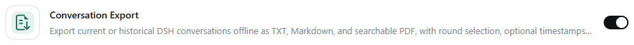

# 对话导出（dsh-ai-exporter）

[English](README.en.md)

将当前或历史 DSH 会话导出为 TXT、Markdown 和可搜索 PDF。

独立维护的 DSH 插件。第三方代码和宿主参考材料保留各自的许可和署名。

## 兼容性与状态

版本 **0.1.1**。本轮实际验证平台：Windows、DSH Desktop **0.2.1-rc.2**。其他平台未测试，不声明支持。

保存位置由 Windows 原生对话框明确选择；默认从当前用户主目录开始，保留已保存的最近目录。PDF 使用系统临时目录或 DSH_EXPORTER_TEMP 指定目录，不再限制盘符。未知事件、未结束回复和不支持内容默认阻止导出；仅在明确允许部分导出后继续，并保留诊断报告。附件仅保留说明，不读取或嵌入附件；数学与 Mermaid 保留原文，不宣称无损转换。

## 安装与卸载

在 Releases 下载与本版本对应的预构建 tgz，先核对 SHA-256，再通过 DSH 官方插件界面选择该包，或执行：

```text
dsh plugin --profile <你的Profile> add <安装包完整路径>
```

重启 DSH 后，在插件管理器核对名称、ID 和版本。更新前备份自己的配置；不要手动修改 node_modules 或 app.asar。卸载使用插件管理器的卸载入口，或 `dsh plugin --profile <你的Profile> remove dsh-ai-exporter`。卸载不保证删除已导出的文件、历史或保留偏好。

## 使用

在会话顶部选择“导出对话”，选择轮次、格式及显示信息，使用 Windows 原生对话框选择保存位置。历史会话可从导出面板加载。

## 构建、测试与排错

安装 Node.js 22+，在本仓库目录配置工具缓存和 TEMP 后运行 `pnpm install --frozen-lockfile --ignore-scripts`、`npm run check`。仅 exporter 的原生 WinForms 辅助程序构建要求 Windows 既有 .NET Framework C# 编译器。

预构建 lib 已随源码保留，因此 GitHub 源码安装不需要运行安装期构建脚本。安装失败先检查 DSH 版本、Profile、包校验值和模块加载错误。不要通过关闭安全策略或覆盖宿主文件排错。完整范围见 [兼容与验证](docs/COMPATIBILITY.md)。

## 许可

见 [LICENSE](LICENSE)；第三方声明见对应许可文件。

## 插件管理器



